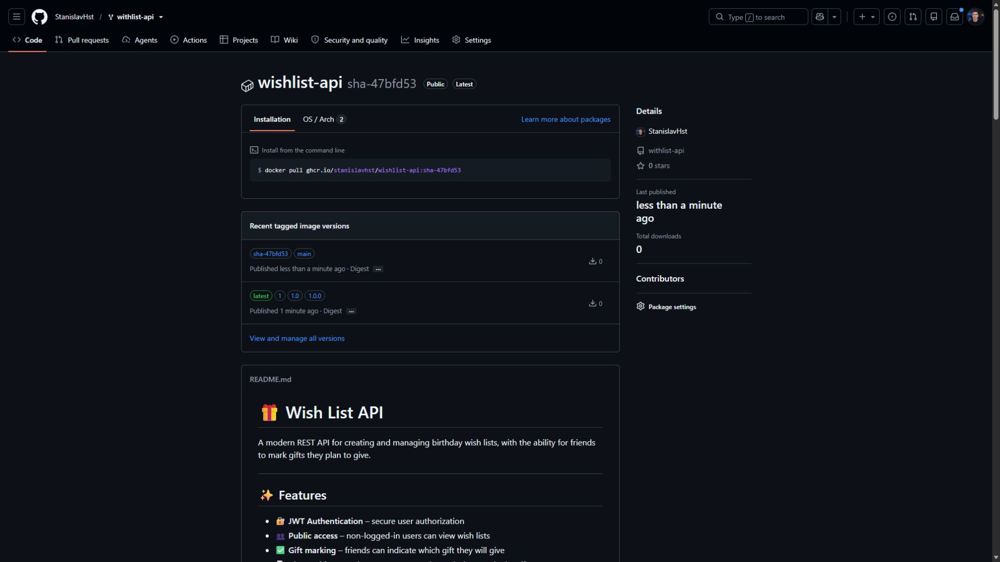

# API у контейнері

Образ використовує Python 3.11 slim. Залежності встановлюються до копіювання коду. Uvicorn слухає 0.0.0.0:8000, а процес працює від appuser. Налаштування передаються через середовище.

## Перевірка 23 листопада 2026

```text
docker run --rm wishlist-api:lab05 whoami
appuser
Container API health, Swagger and PostgreSQL-backed list passed.
Dependency layer reused after a source-file change.
Container stop took 0.92 seconds.
```

Перевірено відсутність .env, lab05.env, .git, tests і .venv у робочій папці образу. Після тимчасової зміни main.py крок RUN pip install був CACHED. Тимчасову зміну повернуто.

## Самостійний запуск API

Потрібні Docker Desktop і приватний lab05.env, створений з .env.example. У ньому задайте власні SECRET_KEY і паролі. Для мережі lab05 встановіть DB_HOST=lab04-postgres, REDIS_URL=redis://lab04-redis:6379/0 і DB_SSLMODE=disable.

Якщо PostgreSQL і Redis з Lab 4 вже існують, один раз підключіть їх до мережі.

```powershell
docker network create lab05
docker network connect lab05 lab04-postgres
docker network connect lab05 lab04-redis
docker start lab04-postgres lab04-redis
docker build -t wishlist-api:lab05 .
docker run --rm --network lab05 --env-file lab05.env wishlist-api:lab05 python -c "from database import engine, Base; import models; Base.metadata.create_all(bind=engine)"
docker run -d --name lab05-api --network lab05 --env-file lab05.env -p 127.0.0.1:8002:8000 wishlist-api:lab05
```

Після перезапуску комп'ютера достатньо docker start lab04-postgres lab04-redis lab05-api. Swagger доступний на http://localhost:8002/docs, health — http://localhost:8002/health.

## CI та реєстр

API image запускається після API tests. PR перевіряє збірку. Main публікує main і sha-тег. Релізний тег v1.0.0 створює теги образу 1.0.0, 1.0, 1 та latest. Вхід у GHCR використовує GITHUB_TOKEN.

Адреса образу — ghcr.io/stanislavhst/wishlist-api. Репозиторій коду зберігає початкове написання withlist-api.

Пакет публічний. Реліз v1.0.0 опублікований. Перевірено завантаження 1.0.0 з окремою порожньою конфігурацією Docker без облікових даних.



## Коротка перевірка

```powershell
docker start lab04-postgres lab04-redis lab05-api
docker run --rm wishlist-api:lab05 whoami
docker run --rm wishlist-api:lab05 ls -a
docker logs lab05-api --tail 10
docker pull ghcr.io/stanislavhst/wishlist-api:1.0.0
```
